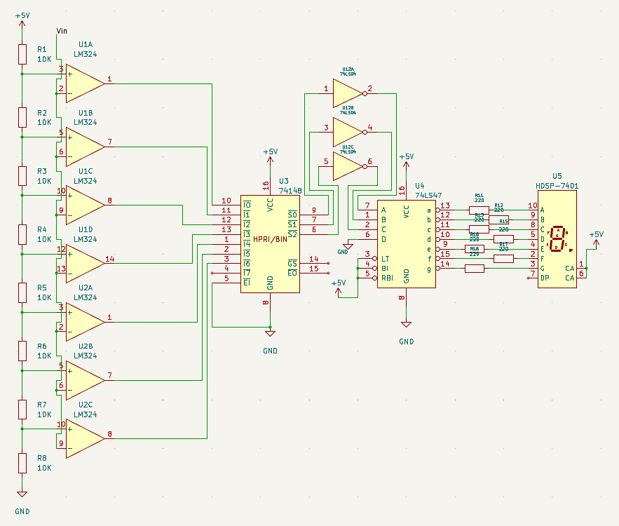
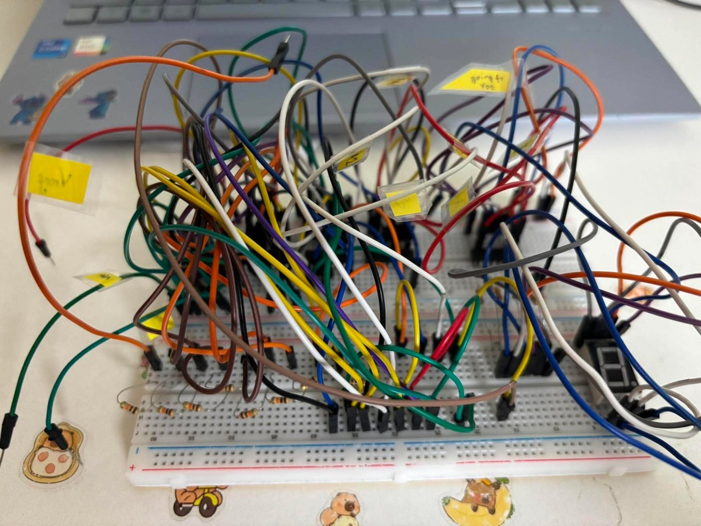
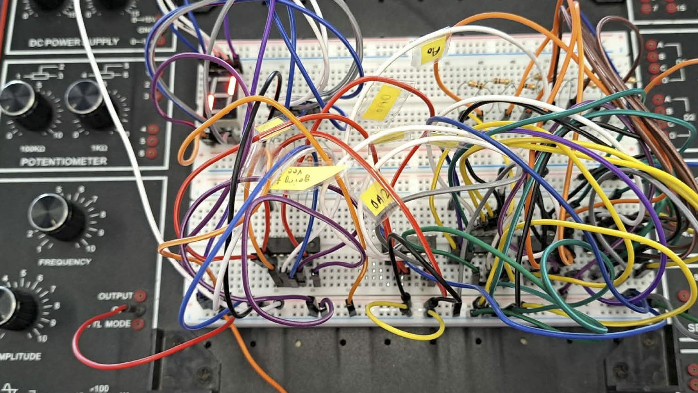
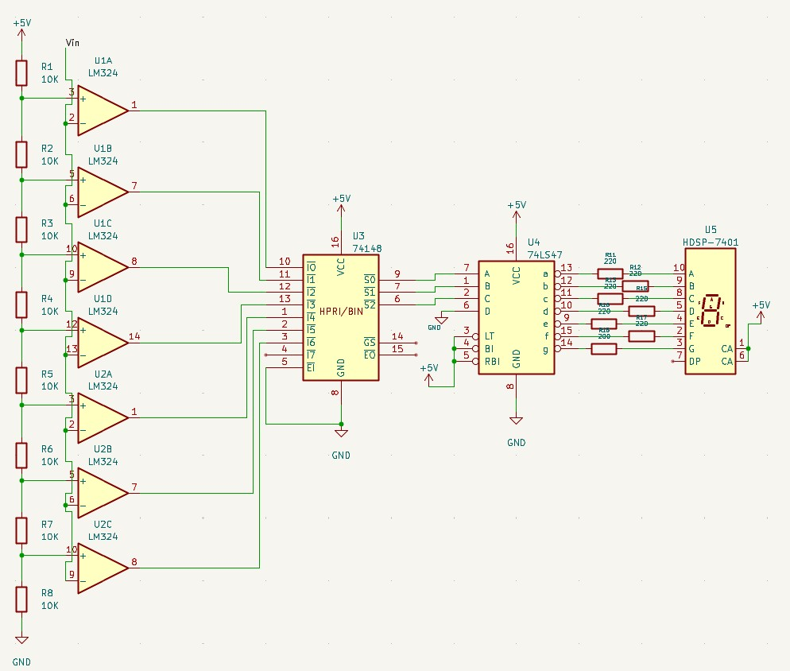

# Digital Voltmeter Without a Microcontroller

A 3-bit digital voltmeter built entirely from discrete hardware, with no Arduino, microcontroller or code. An analog input voltage between 0 and 5 V is converted into one of eight levels by a **flash ADC** and shown as a digit from 0 to 7 on a 7-segment display.

This was a group lab project for **CSE350: Digital Electronics and Pulse Techniques** at BRAC University (2026). The full IEEE-format project report is in [`docs/report.pdf`](docs/report.pdf).



## How it works

```text
Vin ─► Flash ADC ─► 74148 priority ─► 74LS04 ─► 74LS47 BCD-to- ─► 7-segment
       (7 × LM324     encoder           NOT       7-segment          display
       comparators)   (8-to-3)          gates     decoder
```

1. **Resistor ladder.** Eight equal 10 kΩ resistors divide the 5 V supply into seven reference voltages, spaced 0.625 V apart (0.625 V, 1.25 V, … 4.375 V).
2. **Comparators.** Seven comparators (two LM324 quad op-amp ICs) each compare the input voltage with one reference. Together their outputs form a thermometer code: the higher the input, the more comparators switch.
3. **Priority encoder.** The 74148 converts the seven comparator outputs into a 3-bit binary number by reporting the highest active input.
4. **Inverters.** The 74148's outputs are active-LOW, while the 74LS47 decoder expects active-HIGH inputs, so three gates of a 74LS04 hex inverter flip them.
5. **Decoder and display.** The 74LS47 converts the 3-bit value into segment signals for a common-anode 7-segment display (HDSP-7401). 220 Ω resistors limit the current through each segment.

## The build

The circuit was assembled and tested on a breadboard.

<p>
  
  
</p>

## Components

| Part | Quantity | Role |
|---|---|---|
| LM324 quad op-amp | 2 | Seven voltage comparators |
| 10 kΩ resistor | 8 | Reference-voltage ladder |
| 74148 priority encoder (8-to-3) | 1 | Thermometer code to 3-bit binary |
| 74LS04 hex inverter | 1 | Active-LOW to active-HIGH conversion |
| 74LS47 BCD-to-7-segment decoder | 1 | Drives the display segments |
| Common-anode 7-segment display | 1 | Output |
| 220 Ω resistor | 7 | Segment current limiting |
| Breadboard, jumper wires, 5 V supply | | Assembly and power |

The parts were bought locally for about ৳500 in total.

## Design challenge: logic polarity

The first version of the circuit connected the priority encoder straight to the decoder:



This would not decode correctly, because the 74148 signals its result with **active-LOW** outputs while the 74LS47 reads **active-HIGH** inputs. Inserting a 74LS04 inverter on each of the three encoder outputs corrected the polarity, as shown in the final schematic above.

## Testing

The finished circuit was tested on a breadboard by applying a range of input voltage levels and observing the displayed digit, to verify the operation of both the flash ADC and the display stage.

## Possible improvements

- More comparator stages for a higher-resolution ADC (for example, 4 bits gives 16 levels).
- Several 7-segment displays to show the actual voltage with a decimal point instead of a level number.
- Signal conditioning and automatic range selection for inputs above 5 V.

## Team

- Kazi Md. Wasif Ahnaf
- Sneha Debnath
- Fahrim Arabin Farsa
- Tasmin Akter Ridita

Repository maintained by **Fahrim Arabin Farsa** · [GitHub](https://github.com/Farsa27) · [LinkedIn](https://www.linkedin.com/in/fahrim-farsa-a80b21266/)
